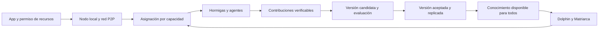

# Plan para completar la visión de LixySwarm

**Fecha:** 2026-10-13

LixySwarm debe ser una red que aprende, conserva lo aprendido y permite utilizarlo desde cualquier PC compatible. Cada máquina aporta dentro de los recursos que su usuario autoriza. La capacidad de entrenamiento debe aumentar al incorporar contribuciones útiles; las máquinas potentes pueden realizar más trabajo y alojar agentes mayores.

El primer hito de producto será completar este recorrido por Internet: una PC recibe trabajo, calcula una contribución real, la red evalúa una nueva versión, otros participantes la adquieren y pueden utilizarla después de apagar la máquina que la produjo. El siguiente hito será realizar ese recorrido desde una app instalable sencilla.

## Principios de la visión

- Cualquier participante puede conectarse sin registro, VPN ni configuración manual de puertos y acceder al conocimiento disponible.
- La contribución es voluntaria y gratuita. CPU, GPU, memoria, almacenamiento y conectividad tienen funciones útiles; la ausencia de GPU permite contribuir en otros roles.
- Las hormigas son los nodos físicos. Los agentes son modelos o expertos alojados en ellos; las sectas agrupan especializaciones. La asignación depende de capacidad medida, disponibilidad y utilidad.
- Cada avance aceptado queda versionado, con procedencia y réplicas en otros participantes. Reinicios y desconexiones deben conservar modelos, memoria global y progreso aceptado.
- Seeds y relays proporcionan transporte y descubrimiento. Los trabajos, las evaluaciones y la autoridad sobre versiones no dependen del VPS del proyecto.
- La Matriarca personal permanece local. La memoria, los datos y las señales que se comparten pertenecen al ámbito global y tienen procedencia verificable.
- Dolphin, Matriarca y sectas deben aportar beneficios medibles a la exploración, la continuidad y la especialización.
- La autonomía significa decidir cuándo aprender, evaluar el resultado, distribuir mejoras y detenerse dentro de límites. Sus etapas se habilitan mediante evidencia de funcionamiento.

## Punto de partida verificado

| Área | Estado | Trabajo pendiente para cumplir la visión |
|---|---|---|
| Internet | Dos PCs en redes NAT distintas intercambiaron señales sintéticas y trabajo de CPU firmado mediante el relay público. | Funcionamiento continuo, estado por nodo, recuperación y segundo relay independiente. |
| Cálculo remoto | Existen trabajos tipados, límites, cancelación, recibos e inferencia remota. | Unirlos a un ciclo de entrenamiento y uso cotidiano. |
| Entrenamiento | Hay cálculo real de gradientes y agregados candidatos; los resultados permanecen sin aplicar. El quórum actual repite el mismo fragmento. | Repartir datos diferentes, actualizar una versión candidata, evaluarla y promoverla. |
| Aprendizaje del enjambre | Las feromonas participan en el aprendizaje. La pérdida principal suma errores individuales; las cabezas de agregación quedan fuera de esa pérdida. La penalización de diversidad usa valores desconectados del gradiente. | Entrenar la calidad del resultado colectivo, su selección de agentes y la diversidad útil. |
| Conocimiento compartido | Existen artefactos por hash, transferencias verificadas y releases con firmas y políticas locales. | Primera versión de referencia, descubrimiento de proveedores, réplica y recuperación completas. |
| Memoria y adaptación | Hay bancos personal/global, legado, sectas y consolidación del Dolphin. | Integración duradera y experimentos que demuestren su utilidad. |
| Entrada a la red | Hay CLI y políticas de contribución. La instalación requiere dependencias de desarrollo y elección manual de modelos. | App instalable, cliente ligero y preparación automática del trabajo compatible. |
| Explorer | Las páginas y la API responden. La API marca sus métricas publicadas como desactualizadas. | Telemetría actual de múltiples nodos y estado real de trabajos y versiones. |

## Arquitectura propuesta

La app controla un servicio local de red y procesos separados para el cálculo. El servicio conserva identidad, pares, políticas, tareas y artefactos entre reinicios. Puede conectarse antes de descargar modelos; los motores de cálculo y sus dependencias se incorporan cuando el hardware y el permiso del usuario permiten utilizarlos.

Los trabajos se identifican por familia de experto, versión del modelo, datos y operación. Agentes compatibles comparten actualizaciones de parámetros. Entre arquitecturas o tamaños diferentes se propone transferencia mediante destilación, ejemplos sintéticos evaluados y memoria global; sus gradientes tienen formas distintas y requieren rutas de aprendizaje diferentes.

Un participante capaz puede coordinar temporalmente un ciclo de una familia de expertos. El trabajo y su estado deben poder retomarse desde otro nodo. La aceptación de versiones combina evaluación, procedencia y firmas según la política de la colonia; el transporte del VPS no otorga autoridad para aceptar modelos.

## Etapas y condiciones de aceptación

### 1 Red continua y Explorer real

Mantener los nodos de las PCs como servicios con arranque, cierre y recuperación limpios. Publicar estado por identidad, con caducidad y secuencias: conectado, preparando modelo, disponible, trabajando, pausado o desconectado. El Explorer debe distinguir capacidad anunciada, capacidad comprobada y trabajo efectivamente realizado. Una publicación no debe sobrescribir la información de otros nodos.

Incorporar un segundo seed/relay público en un dominio de fallo independiente. Registrar versiones, latencia, errores y uso de rutas directas o relayed sin publicar direcciones de operadores. Separar el acceso administrativo por VPN de los ensayos LSP por Internet.

Las tres máquinas actuales permiten el piloto de conectividad y aprendizaje. La prueba de recuperación ante la pérdida del VPS requiere otro relay público independiente; el VPS disponible será el primer relay.

**Aceptación:** tres máquinas reales operan durante 24 horas; el Explorer muestra datos actuales de cada una; los nodos recuperan sesiones tras reinicio y un ensayo con dos relays recupera la comunicación cuando uno desaparece. La operación prolongada y multirregional se amplía posteriormente a siete días.

### 2 App sencilla y cliente ligero

Construir una app instalable para Windows, Linux y macOS. Linux será la referencia inicial de pruebas con las máquinas disponibles; cada plataforma tendrá su propio paquete y validación. La interfaz se desarrolla sobre el servicio local estable, y sus funciones de aprendizaje se habilitan al completar las siguientes etapas.

El recorrido de entrada será instalar, abrir, elegir cuánto aportar y conectar. La app crea la identidad, descubre pares, detecta hardware y presenta progreso de preparación. La conectividad comienza independientemente de las descargas de modelos. La contribución efectiva comienza cuando existe trabajo compatible y están listos sus artefactos.

Las pantallas principales serán Estado, Chat, Recursos y Actividad. Recursos ofrece perfiles equilibrado, máximo y solo cuando el equipo esté disponible, con límites visibles y botón de pausa. Actividad explica qué se está descargando o calculando y qué contribuciones fueron aceptadas. El chat puede pedir inferencia a la red cuando el modelo adecuado no cabe localmente.

Extraer el núcleo de conectividad de las importaciones obligatorias de PyTorch y de los módulos de entrenamiento. El instalador incluye el entorno necesario, y los motores CPU/GPU se preparan según compatibilidad. Las actualizaciones y modelos se verifican antes de activarse. La elección de biblioteca de interfaz se resolverá con una prueba de empaquetado y tamaño en las tres plataformas.

La app configura el almacenamiento local fuera del árbol de desarrollo y crea la clave de cifrado de la memoria personal en el almacén protegido del sistema operativo. La primera versión confiable del catálogo y su política de firmas se incluyen en la configuración inicial para evitar ajustes manuales de modelos o claves.

**Aceptación:** una instalación limpia se conecta sin terminal, Python instalado por el usuario, VPN ni ajustes de router. Objetivo inicial: mostrar conexión en menos de 30 segundos en las redes de prueba, independientemente de una descarga pendiente. Una PC sin GPU aporta en un rol compatible y puede solicitar una respuesta a un nodo disponible.

### 3 Primer ciclo real de entrenamiento distribuido

Publicar un modelo de referencia reproducible que pueda trabajar en la PC de menor VRAM, con datos públicos o sintéticos autorizados, manifiestos, tokenizer, configuración y evaluación fija. Corregir la pérdida de agregación y la diversidad antes de invertir en entrenamientos largos.

Separar dos operaciones: entrenamiento con fragmentos distintos y verificación mediante repetición de muestras seleccionadas. El quórum existente sobre el mismo fragmento es una herramienta de comprobación; repartir más datos requiere un esquema de contribuciones y agregación que reconozca cada fragmento, versión y cantidad de tokens.

Completar el ciclo: repartir fragmentos, recibir contribuciones, verificar esquema y resultados, aplicar una actualización en una versión candidata, evaluar, conservar la versión aceptada y anunciarla. Una contribución tardía o calculada contra otra versión se rechaza o se reprocesa conforme a una política explícita. Los trabajos y posiciones del corpus se recuperan tras reinicios.

El piloto usará las dos PCs conocidas con identidades fijadas y roles de trabajador, coordinador y evaluador claramente registrados. Ese piloto comprueba el aprendizaje y el transporte. La aceptación de aportes de desconocidos necesitará validadores y operadores adicionales; las reglas del quórum abierto se mantienen separadas.

**Aceptación:** ambas PCs procesan fragmentos distintos por Internet y producen una versión que supera los criterios de evaluación fijados antes del ensayo. Otra PC carga esa versión y puede usarla. Reiniciar un nodo conserva el último progreso aceptado y reprograma el trabajo incompleto.

### 4 Conocimiento persistente y disponible

Publicar versiones de expertos con pesos, manifiesto, procedencia, evaluación y cadena de predecesores. Añadir anuncios de proveedores por contenido, descarga reanudable, disponibilidad, réplica, revocación y retorno a una versión anterior. Conservar también el estado necesario para continuar el entrenamiento, dentro de cuotas definidas.

Distribuir memoria global firmada y versionada, con validación previa y separación del ámbito personal. La memoria sintética compartida y el modelo aprendido son dos tipos de conocimiento con reglas de aceptación propias.

Usar almacenamiento de pruebas fuera de Dropbox. Git y Dropbox transportan código de desarrollo; las versiones, los datos y la memoria de la prueba deben llegar por LSP para demostrar la distribución real. El VPS conserva el papel de transporte; las réplicas de conocimiento residen en participantes que consienten almacenamiento.

**Aceptación:** apagar la máquina que produjo una mejora y recuperar la misma versión por hash desde otra. Un nodo con directorio vacío adquiere el conocimiento mediante la red y puede utilizarlo. El piloto verifica dos réplicas; la salida pública exige al menos tres réplicas independientes para los artefactos esenciales.

### 5 Más capacidad y agentes de diferentes tamaños

Medir rendimiento útil, VRAM disponible, latencia y ancho de banda dentro del permiso del usuario. Ajustar tamaño de fragmentos, cantidad de trabajo y frecuencia de sincronización. Mantener una vía de entrada para participantes nuevos y tareas útiles para equipos pequeños.

Alojar familias de expertos de distintos tamaños. Una máquina potente puede procesar más fragmentos, alojar varios agentes o un experto mayor. Los nodos pequeños trabajan con modelos que caben localmente, evaluación, almacenamiento o conectividad. Medir compresión de actualizaciones y amortizar transferencias para que la comunicación por Internet no consuma la ganancia de cálculo.

La asignación emplea rendimiento observado y resultados aceptados, además de declaraciones de hardware. El crédito de contribución distingue trabajo calculado, validado e incorporado a una versión aceptada.

**Aceptación:** una comparación de una PC frente a dos, con la misma evaluación y política de datos, demuestra aumento de tokens útiles procesados o menor tiempo hasta una mejora aceptada. El nodo más potente realiza más trabajo cuando está disponible. Un experto mayor transfiere una mejora evaluada a otra familia sin mezclar gradientes incompatibles.

### 6 Matriarca Dolphin y especialización útiles

Integrar memoria persistente, exploración previa y selección de especialistas en el recorrido real de respuesta. Unificar los roles del runtime y las sectas, entrenar la confianza y conectar el fitness medido con la asignación. Versionar los espacios de feromonas y memoria; las señales de modelos diferentes necesitan compatibilidad o alineación explícita.

Demostrar que los pings del Dolphin y el intercambio de señales mejoran las decisiones de ruta. Ejecutar la consolidación en un servicio duradero. Las sectas pueden nacer, dividirse y retirarse con migración segura de parámetros y estado del optimizador. El legado permite recuperar especializaciones después de una desconexión o retiro.

Separar los estados personales de los utilizados para señales y entrenamiento global. Una señal compartida no debe derivarse de la Matriarca personal o del estado privado de conversación. Las comprobaciones de privacidad cubren todos los canales: memorias, feromonas, datasets, gradientes, historial y publicación de métricas.

**Aceptación:** comparaciones con presupuesto equivalente muestran qué aportan memoria, Dolphin, feromonas y cooperación. Una conversación recupera contexto después de un reinicio, y una especialización recupera su legado. Los ensayos detectan regresiones de calidad, pérdida de diversidad y cruces del límite personal/global.

### 7 Aprendizaje autónomo con límites

Aprender decisiones de hambre metabólica a partir de resultados de ciclos anteriores: necesidad detectada, recursos consumidos, mejora obtenida y diversidad. La colonia elige ciclos acotados, prioriza necesidades, evalúa y conserva resultados, se detiene cuando dejan de ser productivos y consolida memoria.

Implementar GrowthGate con condiciones explícitas de estabilidad, calidad, continuidad y uso de recursos. La promoción de etapa requiere una ventana de observación; una regresión conserva el registro de la experiencia y vuelve a una versión o etapa estable.

**Aceptación inicial:** diez ciclos completos registrados, con programación propia dentro de los permisos del usuario, evaluación, publicación o rechazo, pausa y recuperación. Cada decisión permite reconstruir su resultado y costo.

### 8 Red abierta y ecosistema

Validar paquetes e instaladores en equipos nuevos de cada plataforma. Añadir aislamiento de procesos de trabajo, límites comprobables, controles de API, HTTPS, rotación de claves, pruebas de carga y aportes malformados. Establecer reglas de aceptación de versiones entre operadores independientes y recuperación ante pérdida de un operador.

Ampliar descubrimiento y disponibilidad de contenido para múltiples regiones y colonias, preservando políticas personales. Introducir capacidades multimodales cuando sus datos, agentes y evaluación sean compatibles con el ciclo ya operativo.

La automodificación del código es una fase posterior: candidatos dentro de un entorno aislado, evaluación y regresiones, distribución versionada y retorno a una versión estable. Se habilita después de demostrar el ciclo de aprendizaje y sus condiciones de crecimiento.

**Aceptación:** un participante nuevo instala la app, conecta, aporta según su capacidad y utiliza conocimiento aprendido por otros. La red conserva conocimiento y recupera trabajo ante pérdida de nodos y de un servicio público. Las etapas de crecimiento y las capacidades nuevas cumplen sus evaluaciones antes de activarse.

## Próximo tramo de implementación

1. Servicio continuo en las PCs y telemetría firmada por nodo; Explorer con frescura, recursos y trabajos reales.
2. Cliente ligero y prototipo de app para conexión, recursos, pausa y preparación de modelos.
3. Modelo compatible, corpus público y evaluación reproducible para el piloto con las dos PCs.
4. Trabajos sobre fragmentos distintos y versión candidata con actualización real y evaluación.
5. Publicación, adquisición por LSP y prueba de persistencia después de apagar el nodo productor.

La app empieza durante este tramo. Su promesa de aprendizaje compartido se habilita al superar los criterios del ciclo completo. No se fija una fecha de finalización hasta medir instalación, memoria, transferencia y rendimiento del primer piloto.

## Seguimiento de decisiones y avance

El goal activo se registra en [VISION_PROGRESS.md](VISION_PROGRESS.md), con evidencia, decisiones y criterios todavía pendientes.

Cada decisión que cambie el modelo de colaboración, la persistencia, el reparto por capacidad o la autonomía se registra con motivo, efecto sobre la visión, alternativa y prueba de aceptación. Los cambios se documentan en el mismo commit que los implementa. El avance se mide por condiciones cumplidas, versiones reproducibles y ensayos entre máquinas reales.

El flujo de desarrollo usa el repositorio público: las PCs publican cambios por Git, el VPS los adquiere por Git y Dropbox sincroniza el árbol de trabajo de las PCs. La VPN proporciona administración. Los ensayos de comunicación, aprendizaje y adquisición de conocimiento utilizan Internet y LSP.

## Páginas actuales del VPS

- [Explorer](http://31.97.9.54:8080/swarm-explorer.html) y [entrada principal](http://31.97.9.54:8080/).
- [Interfaz de chat](http://31.97.9.54:8080/chat.html).
- [Documentación de la API](http://31.97.9.54:8080/api/docs).
- [Estado publicado](http://31.97.9.54:8080/api/swarm/status) y [salud de la API](http://31.97.9.54:8080/api/health).

El Explorer responde, pero la API marca los datos como desactualizados al inicio de este plan. La interfaz de chat existe; el acceso al modelo por la red forma parte de la integración pendiente. El frontend y el transporte público tienen funciones separadas.

## Referencias del proyecto

- [Visión del paper](paper/LixySwarm_AntElephantDolphin.pdf).
- [Implementación y uso actual](README.md).
- [Arquitectura LSP y respaldo de relay](LSP_ARCHITECTURE.md).
- [Correspondencia con el paper](PAPER_COMPLIANCE.md).
- [Pendientes de ingeniería](PENDIENTES_2026-06-05.md).
- [Condiciones de operación pública](INTERNET_SCALE_READINESS.md).
